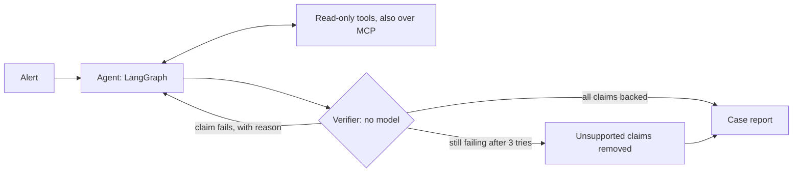

# aml-case-agent

An agent that investigates anti-money laundering alerts and writes a case report in which every
statement is checked against the bank's records before an analyst sees it.

Built with LangGraph. The data tools are also served over MCP. All data is synthetic.

## Why

Analysts stop using an AI summary the first time one sentence cannot be traced to a transaction.
So the hard part of an investigation agent is not the writing. It is proving that what it wrote is true.

This repo does that with a verifier that uses no model. A report is a list of claims. Each claim
cites record ids, and the verifier checks that

1. every cited record exists and belongs to the alerted account,
2. any total, count, max or min the claim states matches the cited transactions,
3. every large number in the sentence can be traced to those records.

A claim that fails goes back to the model with the reason. If the model cannot fix it, the claim is
removed. It never reaches the analyst.



## Run it

```bash
pip install -r requirements.txt
python -m amlagent.data                          # builds data/bank.db and data/labels.json
python -m amlagent.evals --investigator baseline # no model or API key needed
pytest -q
```

With a model, through any OpenAI-compatible endpoint. That includes an open-source model you host
yourself, by pointing `OPENAI_BASE_URL` at your own server.

```bash
export OPENAI_API_KEY=...            # and OPENAI_BASE_URL=http://your-server/v1 for a self-hosted model
export AML_MODEL=gpt-4o-mini
python -m amlagent.evals --investigator llm --limit 10
python -m amlagent.evals --investigator llm --mcp     # same run, tools loaded through the MCP server
```

The eval exits with code 1 when typology accuracy falls below the gate or a true case is closed, so
it can block a release in CI.

## The data

`amlagent/data.py` generates 40 customers, about 9,700 transactions over nine months, and 40 alerts.
Half the alerts are real cases of four typologies: structuring, pass-through, funnel account and a
high-risk corridor. The other half are false positives that fire the same rules: a cash-heavy
restaurant, a property sale, an online seller, an importer paying a known supplier. The rule name
never gives the answer away. Labels live in a separate file that the tools cannot read.

## Results

40 alerts, half real cases and half false positives. The model is Qwen2.5-7B-Instruct (AWQ, 4-bit)
served with vLLM on a single 16 GB T4 GPU, 8 alerts at a time.

| | Rule-based baseline | Qwen2.5-7B agent |
|---|---|---|
| Alerts completed | 40 / 40 | 40 / 40 |
| False alerts correctly closed | 20 / 20 | 19 / 20 |
| Real cases escalated | 20 / 20 | 7 / 20 |
| Real cases given the right typology | 20 / 20 | 2 / 20 |
| Claims grounded on first submission | 100% | 68% |
| Unsupported claims removed before the analyst saw them | 0 | 32 |

What the model gets wrong, by typology:

| Real typology | Model said |
|---|---|
| Funnel account (5) | none: 5 |
| Pass-through (5) | structuring: 3, none: 2 |
| Structuring (5) | none: 4, no valid report: 1 |
| High-risk corridor (5) | correct: 2, structuring: 2, none: 1 |

How to read this:

- The verifier did its job. A third of the model's first drafts had claims the records did not back.
  32 such claims were sent back and, when the model could not fix them, removed. None reached the report.
- A 7B model is good at closing false alerts and poor at naming the typology. It never identified
  structuring correctly, and it used "structuring" as a catch-all for other patterns.
- The baseline's perfect score is expected: its rules were written by the same person who wrote the
  data generator. It is there as a reference and to test the pipeline end to end.

Run it yourself on any GPU with `bash scripts/run_eval_gpu.sh`, or point `OPENAI_BASE_URL` at a larger model.

## What went wrong first

The first two runs failed for mechanical reasons, not because of the model's judgement.

1. **The agent never finished.** 3 of 4 alerts hit the step limit without handing in a report. The model
   kept asking for more data. Fixed with a `case_overview` tool that returns what an analyst opens first
   in one call, and a budget of 5 turns after which the model can only call `submit_report`.
2. **The context overflowed.** 2 of 8 alerts went past the 32k-token context, because raw transaction
   listings are large. Fixed by capping what each tool returns to the model to about 1,700 tokens.
   The verifier still reads the full records.
3. **Chat turns escaped the budget.** A model that replied with text instead of a tool call was nudged
   and not counted. Those turns now count too.

Each fix has a test, so the failure cannot come back silently.

## Limits

- Synthetic data is cleaner than a real bank's. Real cases mix typologies and have missing fields.
- The verifier proves a claim is backed by records. It does not prove the conclusion drawn from them is right.
  That is what the labelled eval is for.
- Four typologies, one account per alert, no network view across customers.

## Layout

```
amlagent/data.py        synthetic bank and planted cases
amlagent/tools.py       read-only investigation tools
amlagent/mcp_server.py  the same tools over MCP
amlagent/schema.py      CaseReport, Claim, Check
amlagent/verify.py      the deterministic verifier
amlagent/graph.py       the LangGraph agent
amlagent/baseline.py    rule-based investigator
amlagent/evals.py       scoring and release gate
scripts/serve_vllm.sh   serve an open-source model with vLLM on one GPU
scripts/run_eval_gpu.sh start the server and run the labelled eval
tests/                  15 tests, including the full agent loop with a scripted model
```
